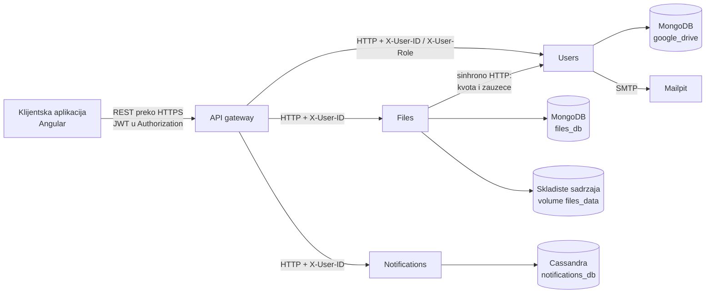

# Dizajn sistema (zahtev 2.1)

Za svaki servis: koju bazu koristi, s kojim entitetima radi i koji su im
atributi. Na kraju su stilovi komunikacije izmedju servisa.

> Svako proverava i dopunjuje svoj servis: **Users** - Mateja,
> **Files** - Milos, **Notifications** i **API gateway** - Igor.

## Pregled



Svaki servis ima **svoju** bazu i nijedan ne cita tudju. Veza izmedju podataka
razlicitih servisa ide iskljucivo preko ID-ja (npr. `ownerId` u Files servisu
je `_id` korisnika iz Users servisa) i preko API poziva.

---

## Users - dokument baza (MongoDB, baza `google_drive`)

Kredencijali, uloge, osnovni podaci i kvota korisnika (1.1, 1.2, 1.3, 1.8).

### `users`

| Atribut | Tip | Opis |
|---|---|---|
| `_id` | ObjectID | ID korisnika; ostali servisi ga koriste kao referencu |
| `first_name`, `last_name` | string | ime i prezime |
| `email` | string | jedinstven (unique indeks) |
| `password_hash` | string | bcrypt hes sa salt-om (2.19) |
| `password_changed_at` | datum | za minimalnu (1 dan) i maksimalnu (60 dana) starost lozinke |
| `role` | string | `user` ili `admin` |
| `storage_quota` | int64 | dodeljena kvota u bajtovima |
| `used_storage` | int64 | zauzeto; menja ga Files servis posle otpremanja |
| `verified` | bool | da li je nalog potvrdjen preko mejla |
| `email_verification_token_hash`, `..._expires_at` | string, datum | jednokratan token za potvrdu naloga |
| `otp_hash`, `otp_expires_at`, `otp_attempts` | string, datum, int | jednokratna lozinka za prijavu i broj promasaja |
| `password_reset_token_hash`, `..._expires_at` | string, datum | link za reset lozinke |
| `magic_link_token_hash`, `..._expires_at` | string, datum | link za prijavu bez lozinke (1.3) |
| `created_at`, `updated_at` | datum | |

U bazi se cuvaju samo **hesevi** tokena i kodova, nikad sami tokeni.

### `quota_requests`

| Atribut | Tip | Opis |
|---|---|---|
| `_id` | ObjectID | |
| `user_id` | ObjectID | ko trazi povecanje |
| `requested_quota` | int64 | trazena kvota u bajtovima |
| `status` | string | `pending`, `approved` ili `rejected` |
| `created_at`, `updated_at` | datum | |

---

## Files - dokument baza (MongoDB, baza `files_db`) + skladiste sadrzaja

Metapodaci o folderima i datotekama (1.4, 1.5, 1.6). Sam sadrzaj datoteka je
u skladistu (sada volume na disku; za ocenu 7 MinIO), a u bazi je samo
referenca na njega.

### `folders`

| Atribut | Tip | Opis |
|---|---|---|
| `_id` | ObjectID | |
| `name` | string | naziv |
| `ownerId` | string | `_id` korisnika iz Users servisa |
| `parentId` | ObjectID / null | roditeljski folder; `null` = koren |
| `ancestors` | niz ObjectID | svi nadredjeni folderi od korena; putanja jednim upitom |
| `createdAt`, `updatedAt` | datum | |

Jedinstven indeks `(ownerId, parentId, name)`: baza sama sprecava dva foldera
istog naziva na istom mestu.

### `files`

| Atribut | Tip | Opis |
|---|---|---|
| `_id` | ObjectID | |
| `name` | string | naziv |
| `ownerId` | string | `_id` korisnika iz Users servisa |
| `folderId` | ObjectID / null | folder; `null` = koren |
| `mimeType` | string | tip odredjen **po sadrzaju**, ne po ekstenziji |
| `size` | int64 | velicina u bajtovima |
| `checksum` | string | SHA-256 sadrzaja, za proveru integriteta (2.18) |
| `storageKey` | string | kljuc sadrzaja u skladistu; ne salje se klijentu |
| `version` | int | broj verzije, raste pri svakoj novoj verziji |
| `createdAt`, `updatedAt` | datum | `updatedAt` = vreme poslednje izmene |

Jedinstven indeks `(ownerId, folderId, name)`.

---

## Notifications - wide-column baza (Cassandra, keyspace `notifications_db`)

Notifikacije korisnika (1.7).

### `notifications_by_user`

```sql
CREATE TABLE notifications_by_user (
  user_id         text,
  created_at      timestamp,
  notification_id timeuuid,
  message         text,
  is_read         boolean,
  PRIMARY KEY ((user_id), created_at, notification_id)
) WITH CLUSTERING ORDER BY (created_at DESC, notification_id DESC);
```

| Atribut | Uloga | Opis |
|---|---|---|
| `user_id` | particioni kljuc | `_id` korisnika iz Users servisa (tekst, ne UUID) |
| `created_at` | klasterujuca kolona | vreme nastanka; redovi su vec sortirani od najnovijeg |
| `notification_id` | klasterujuca kolona | `timeuuid`, razlikuje notifikacije u istoj milisekundi |
| `message` | | tekst notifikacije |
| `is_read` | | da li je procitana |

Tabela je napravljena **po upitu** ("query-driven" dizajn): jedini upit je
"notifikacije jednog korisnika, najnovije prve". Zato je korisnik particioni
kljuc (sve njegove notifikacije su na istom cvoru), a vreme klasterujuca
kolona (sortiranje bez `ORDER BY`).

---

## API gateway - bez baze

Jedina ulazna tacka (2.2). Proverava JWT, uklanja `X-User-ID` / `X-User-Role`
koje je klijent eventualno podmetnuo i postavlja ih iz tokena, ogranicava broj
zahteva po korisniku (2.17) i govori HTTPS prema klijentu (2.19).

| Putanja | Servis | Zastita |
|---|---|---|
| `/api/users/...` | Users | javno (registracija, prijava, OTP, reset, magicni link) |
| `/api/users/users/...` | Users | JWT, **samo GET** |
| `/api/users/quota-requests` | Users | JWT |
| `/api/users/admin/...` | Users | JWT + uloga `admin` |
| `/api/files/...` | Files | JWT |
| `/api/notifications/...` | Notifications | JWT |

---

## Stilovi komunikacije

| Od - do | Stil | Zasto |
|---|---|---|
| Klijent -> gateway | sinhrono, REST preko HTTPS, JWT u `Authorization` | jedna ulazna tacka, sifrovan saobracaj |
| Gateway -> servisi | sinhrono HTTP (reverse proxy), identitet u `X-User-ID` | servisi ne parsiraju JWT; nisu dostupni spolja (samo `expose`) |
| Files -> Users, citanje kvote | **sinhrono** HTTP `GET /users/{id}/quota` (2.5) | otpremanje ne sme da pocne dok se ne zna da ima mesta |
| Files -> Users, promena zauzeca | sinhrono HTTP `POST /users/{id}/storage` | posle uspesnog otpremanja; neuspeh se loguje i ne obara otpremanje |
| Users -> Mailpit | SMTP | potvrda naloga, OTP, reset lozinke, magicni link |

Poziv Files -> Users ide **direktno**, ne kroz gateway: gateway trazi JWT
korisnika, a Files servis u tom trenutku govori u svoje ime.

Asinhrona komunikacija (2.9, npr. generisanje notifikacija kada neko podeli
fajl) nije deo ocene 6.
